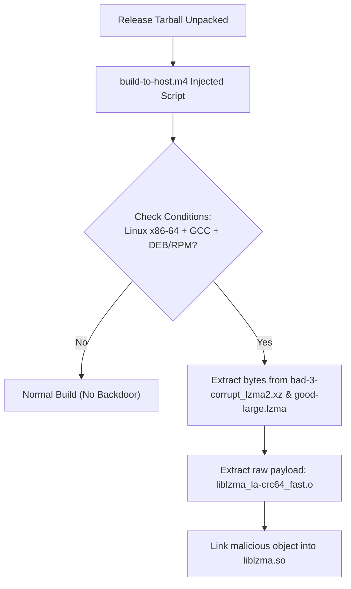

# CS50 Cybersecurity Final Project: Slide Deck Content
## Topic: The XZ Utils Backdoor (CVE-2024-3094)
**Target Presentation Length:** 7 to 10 Minutes  
**Audience:** Course Staff (CS50 Cybersecurity) — Expects low-level technical understanding  
**Incident Date:** March 2024  
**CVE Identifier:** CVE-2024-3094  

---

### Slide 1: Title & Mandatory Course Compliance
**Visual Layout:** Clean, dark-mode cybersecurity theme. High-contrast typography. Professional academic header.
**On-Slide Content:**
- **Project Title:** The Ghost in the Tarball: Deconstructing the XZ Utils Supply Chain Backdoor
- **Course:** Harvard University — CS50’s Introduction to Cybersecurity (Final Project)
- **Student Details:**
  - **Full Name:** `[Insert Your Full Name Here]`
  - **Location:** `[Insert Your City, Country - Optional]`
  - **edX Username:** `[Insert Your edX Username Here]`
  - **GitHub Username:** `omsg5368`
- **Submission Metadata:**
  - **Recording Date:** `[Insert Video Recording Date, e.g., October 8, 2026]`
  - **Incident Occurrence:** March 2024
  - **Vulnerability Identifier:** CVE-2024-3094 (CVSS 10.0 Critical)
- **Status:** Caught before widespread production manifestation by an observant engineer

> **Mandatory Verbal Requirements for Slide 1 (Spoken by You at 0:00–0:45):**
> 1. State your name, edX username, and GitHub username verbally.
> 2. State the exact recording date verbally.
> 3. State the month and year of the incident (March 2024) and mention CVE-2024-3094.
> 4. State why you selected this topic and how it relates to CS50 Cybersecurity (e.g., *"I chose this incident because it represents the most sophisticated real-world software supply chain attack in history, directly applying course concepts in software security, authentication bypass, dynamic linking, and social engineering."*).

---

### Slide 2: Executive Summary & The 500ms Anomaly
**Visual Layout:** Split layout. Left: Timeline graphic of discovery. Right: Key facts and metrics box.
**On-Slide Content:**
- **The Accidental Discovery:**
  - March 29, 2024: Discovered by Andres Freund, a PostgreSQL developer at Microsoft.
  - Investigated micro-benchmarks showing OpenSSH `sshd` taking ~500ms longer per login attempt.
  - Valgrind profiling flagged unexpected memory errors in `liblzma.so`.
- **Target & Scope:**
  - Infiltrated `xz-utils` versions 5.6.0 and 5.6.1.
  - Affected bleeding-edge distributions: Debian Unstable (Sid), Fedora Rawhide/40, openSUSE Tumbleweed, Arch Linux.
  - Caught days before landing in enterprise production releases (Debian Stable, Ubuntu 24.04 LTS).
- **Core Severity:**
  - CVSS Score: **10.0 Critical** (Unauthenticated Remote Code Execution as `root` via SSH).
  - Designed for targeted, untraceable root-level access across the global internet.

---

### Slide 3: Explicit Relation to CS50 Cybersecurity
**Visual Layout:** 4-quadrant grid showing the intersection with core course domains.
**On-Slide Content:**
1. **Software & Application Security (Weeks 2 & 4):**
   - Compromised upstream build pipelines (Autotools/M4).
   - Obfuscated multi-stage injection payload hiding inside test tarballs.
2. **System Security & Operating Systems (Weeks 3 & 5):**
   - Exploitation of shared library dependencies (`sshd` linking `libsystemd` -> `liblzma`).
   - Abuse of ELF binary loader mechanisms: GNU Indirect Functions (`IFUNC`) and Global Offset Table (`GOT`).
3. **Authentication & Cryptography (Weeks 1 & 6):**
   - Interception of OpenSSL's `RSA_public_decrypt` routine.
   - Attacker cryptographic gatekeeping using Ed448 digital signatures.
4. **Human Factors & Social Engineering (Week 7):**
   - Multi-year social engineering campaign exploiting volunteer maintainer burnout.
   - Astroturfed peer pressure to gain repository commit rights.

---

### Slide 4: Phase 1 – The Long-Con Social Engineering Campaign
**Visual Layout:** 2-year timeline infographic tracking the persona's evolution from 2021 to 2024.
**On-Slide Content:**
- **The Threat Actor:**
  - Persona created: `Jia Tan` (GitHub handle: `@JiaT75`), active since late 2021.
  - Exhibited high patience, making legitimate bug fixes and documentation commits to earn trust.
- **Exploiting Maintainer Fatigue:**
  - XZ Utils maintained by a single volunteer, Lasse Collin, experiencing burnout and mental exhaustion.
  - Sockpuppet accounts (`Dennis Ens`, `Jigar Kumar`) began harassing Collin on public mailing lists, demanding co-maintainership.
- **The Takeover (2023–2024):**
  - Jia Tan granted co-maintainer access and PGP release keys.
  - Gradually introduced subtle modifications: disabled test sandboxing (`CMake` safety checks), suppressed security warnings, and prepared the build pipeline.

---

### Slide 5: Phase 2 – The Multi-Stage Build Injection Pipeline
**Visual Layout:** High-level architectural flowchart showing how the backdoor bypassed GitHub git history.
**On-Slide Content:**
- **Why Git Commits Looked Completely Clean:**
  - Malicious logic was **never committed to GitHub source trees**.
  - Injected solely into official upstream release tarballs (`.tar.gz`) during packaging.
- **Multi-Stage De-obfuscation Pipeline:**
  1. `m4/build-to-host.m4`: Upstream macro file tampered with during distribution release.
  2. Test File Steganography: Two seemingly innocent, corrupted test files (`bad-3-corrupt_lzma2.xz` and `good-large_compressed.lzma`) contained raw binary payload slices.
  3. Conditional Trigger: Executed only if building:
     - x86-64 Linux architecture
     - Using GCC / Clang
     - Inside a Debian (`.deb`) or Red Hat (`.rpm`) package build environment.
- **Mermaid Diagram Representation:**

---

### Slide 6: Phase 3 – Deep Technical Execution: The IFUNC Hook
**Visual Layout:** Low-level memory & dynamic linking diagram (ELF linker, IFUNC, GOT).
**On-Slide Content:**
- **The Unintended Dependency Chain:**
  - OpenSSH (`sshd`) does **not** natively use `liblzma`.
  - Major Linux distros (Debian, Ubuntu, Fedora) patched OpenSSH to link `libsystemd` for `sd_notify` socket activation.
  - `libsystemd` pulled in `liblzma` for decompression — giving `liblzma` direct residence inside the privileged `sshd` process memory!
- **Exploiting GNU Indirect Functions (`IFUNC`):**
  - `IFUNC` allows dynamic runtime selection of performance-optimized functions (e.g., hardware-accelerated CRC64).
  - IFUNC resolvers execute **before** glibc's Relocation Read-Only (`RELRO`) locks down memory!
- **Hijacking the Global Offset Table (GOT):**
  - When `liblzma` loads, the backdoor's IFUNC resolver executes in memory.
  - Searches the runtime symbol table for OpenSSL's `RSA_public_decrypt`.
  - Overwrites the function pointer to point to the backdoor's handler.

---

### Slide 7: Phase 4 – The Payload & Remote Code Execution Mechanics
**Visual Layout:** Attack flow diagram illustrating the incoming SSH connection and cryptographic signature check.
**On-Slide Content:**
- **Trigger via Public Key Handshake:**
  - Standard SSH client initiates connection to `sshd`.
  - When `sshd` invokes `RSA_public_decrypt` to verify the client's public key certificate, control diverts to the backdoor.
- **Cryptographic Gatekeeping (Ed448):**
  - The backdoor reads the certificate payload from the SSH client.
  - Validates that the payload is signed with the attacker's **hardcoded Ed448 public key**.
  - **Critical Design Choice:** Nobody else on the internet could exploit this backdoor; only the attacker possessed the matching private key!
- **Remote Execution & Evasion:**
  - If valid signature: Backdoor unpacks the command and invokes `system()` to run arbitrary shell commands as `root`.
  - It then suppresses OpenSSH's connection logging.
  - If invalid signature or normal user: Passes execution seamlessly back to the real `RSA_public_decrypt`. Zero crashes, zero logs.

---

### Slide 8: Why Traditional Security Controls Failed
**Visual Layout:** Comparative breakdown table of standard enterprise defenses vs. how the attacker defeated them.
**On-Slide Content:**
| Traditional Defense | How the XZ Backdoor Evaded It |
| :--- | :--- |
| **Git Repository Code Review** | Malicious code never lived in git; injected only during release tarball generation. |
| **Signature Antivirus & EDR** | Payload was fragmented across test files and assembled at link time in memory. |
| **Compiler Warnings & Linters** | Jia Tan authored commits suppressing build warnings and bypassing test suites. |
| **Memory Protections (RELRO)** | Payload hijacked pointers during IFUNC resolution *before* memory was marked read-only. |
| **Replay Attacks & Honeypots** | Ed448 signature requirement prevented researchers from triggering payload without the key. |

---

### Slide 9: Strategic Recommendations & Engineering Countermeasures
**Visual Layout:** Actionable 4-pillar defense framework for security engineers and system architects.
**On-Slide Content:**
1. **Enforce the Principle of Least Privilege in Dependency Trees:**
   - Eliminate unnecessary transitive dependencies in high-privilege daemons.
   - Example: OpenSSH upstream now uses separate socket-activation stubs without linking `libsystemd` or `liblzma`.
2. **Mandate Hermetic, Verifiable Build Pipelines:**
   - Adopt **SLSA (Supply-chain Levels for Software Artifacts)** Level 3+.
   - Binary packages must be built strictly from auditable git commit SHAs, never vendor-supplied release tarballs.
3. **Harden Linker & Dynamic Resolution Mechanisms:**
   - Restrict or audit `IFUNC` resolvers in security-sensitive shared libraries.
   - Enforce stricter loader protections and dynamic linker symbol isolation.
4. **Institutional Support for Open-Source Infrastructure:**
   - Financial and administrative backing for sole maintainers of foundational libraries.
   - Enforce multi-party PGP/sigstore code signing for upstream releases.

---

### Slide 10: Conclusion & References
**Visual Layout:** Clean summary card with formal academic and industry references.
**On-Slide Content:**
- **Key Takeaways:**
  - Modern threats increasingly target the human and build-chain seams rather than cryptographic algorithms.
  - Andres Freund's vigilance underscores the power of anomaly detection and low-level performance profiling.
  - Security architecture must assume dependencies can be malicious.
- **Authoritative References:**
  1. Freund, Andres. *"backdoor in upstream xz/liblzma leading to sshd accept-call hijacking."* Openwall oss-security mailing list (March 29, 2024).
  2. Cybersecurity and Infrastructure Security Agency (CISA). *Alert: Vulnerability in XZ Utils Affecting Multiple Linux Distributions* (CVE-2024-3094).
  3. Valsorda, Filippo. *"Inside the XZ Utils Backdoor"* (Technical Deconstruction, April 2024).
  4. Boehm, Evan. *"Everything I Know About the XZ Backdoor"* (Investigative Timeline, March 2024).
  5. Harvard CS50: Introduction to Cybersecurity course materials (Lecture 2: Software, Lecture 5: Systems).
